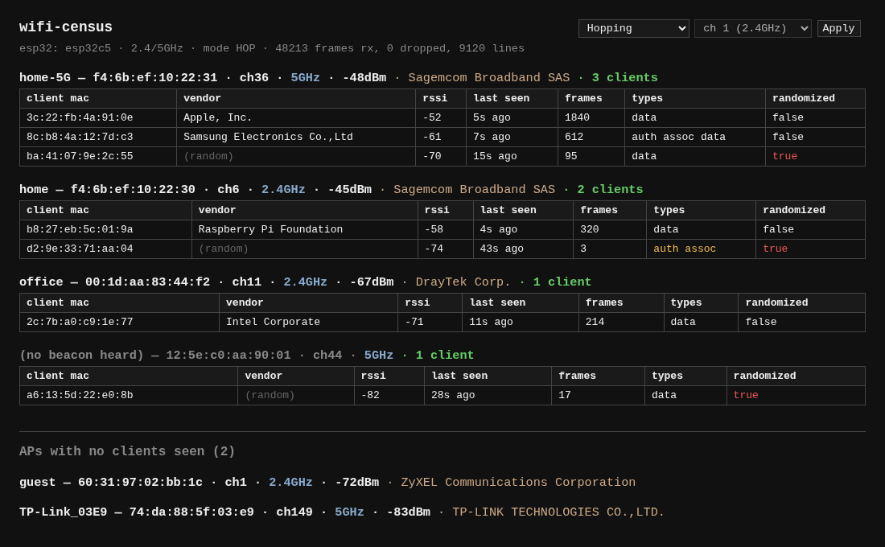

# wifi-census

Passive Wi-Fi census for site surveys: captures 802.11 frames with an ESP32 and correlates client devices with the access points they are connected to, on 2.4GHz and 5GHz (ESP32-C5).



## How it works

The firmware sniffs 802.11 frames in promiscuous mode while hopping channels and sends one line per event over serial. The Go backend aggregates them, adds vendor names from the IEEE OUI registry and serves the dashboard.

## Usage

```sh
# firmware (ESP-IDF 5.5)
cd firmware && idf.py set-target esp32c5 build flash

# backend
go -C backend build && ./backend/backend -port /dev/ttyUSB0
```

Open http://localhost:8080.

## Tests

```sh
cc -I firmware/main firmware/test/test_dot11.c firmware/main/dot11.c -o /tmp/t && /tmp/t
go -C backend test ./...
```

## Limitations

- 5GHz needs an ESP32-C5; other ESP32 chips are 2.4GHz only.
- Single antenna, 20MHz: devices on wide channels show up only when they join.

Use it only on networks you own or are authorized to monitor.
